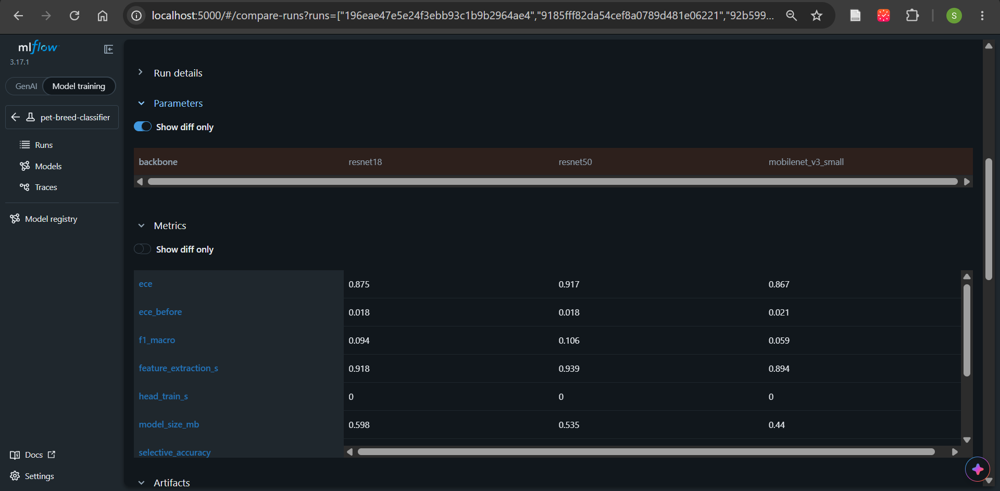
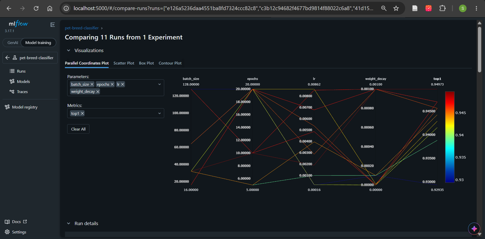
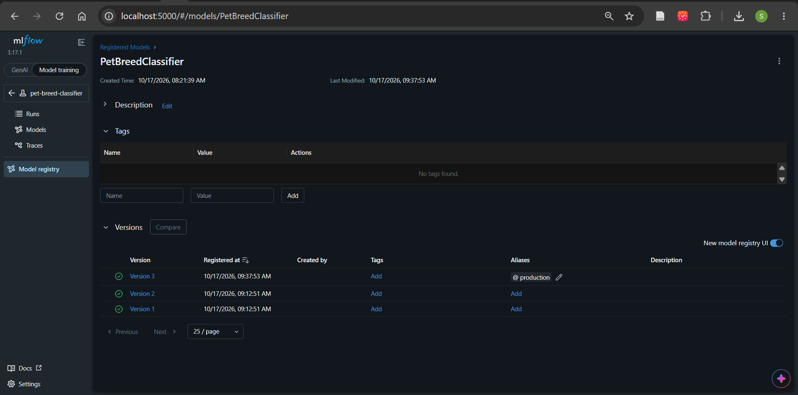
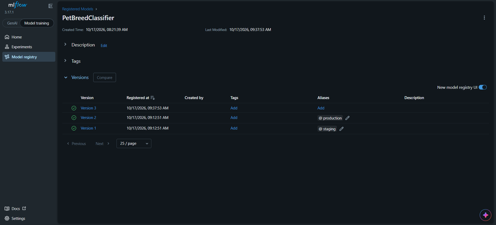
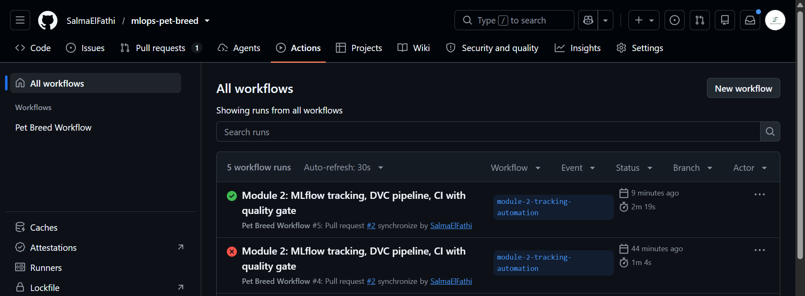
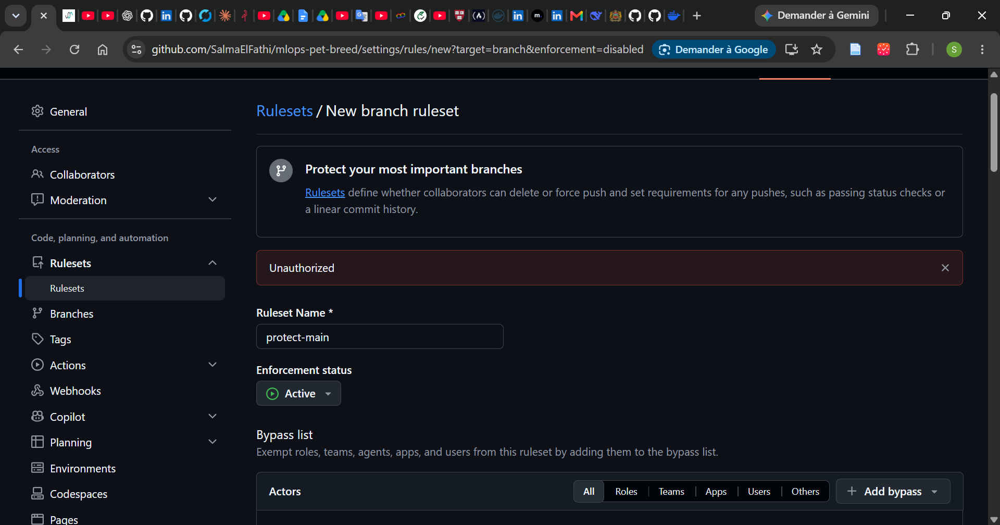
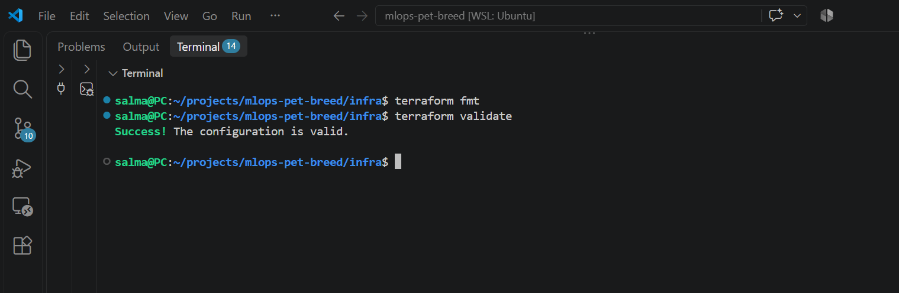
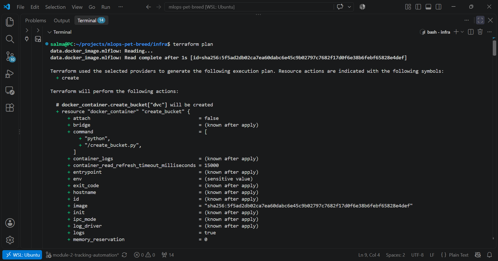
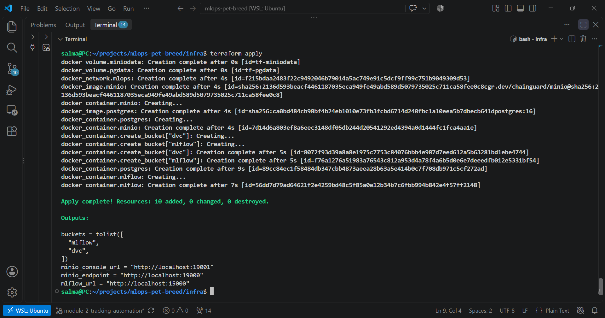
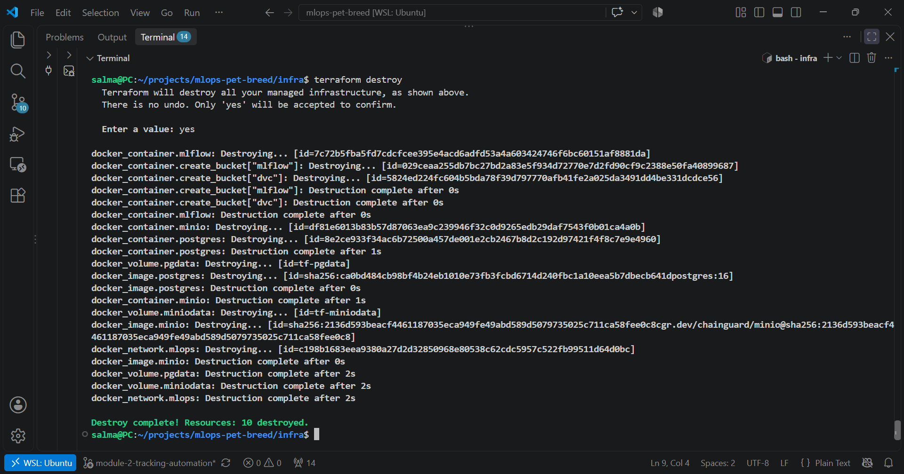

# Module 2 report

## 1. Tracking stack

- Services (Docker Compose, profile `mlops`): PostgreSQL 16 (backend store), MinIO (artifact store), MLflow 3.17.1 server. The API still starts alone with `docker compose up`.
- MLflow is served with `--serve-artifacts`: the client only knows the tracking URI, and the server talks to MinIO.
- MinIO image: `minio/minio` and `minio/mc` are no longer published on Docker Hub, so I use the Chainguard build, pinned by digest (MinIO `RELEASE.2026-09-22T19-25-18Z`). The `mc` client being gone, the bucket `mlflow` is created by a small `boto3` script (`scripts/create_bucket.py`), idempotent.
- MLflow server image: built from `python:3.12-slim` with `psycopg2-binary` and `boto3` (1.33 GB). The backend URI names the driver explicitly (`postgresql+psycopg2://`), otherwise SQLAlchemy looks for `psycopg`, which is not installed.
- MLflow 3.5+ validates the `Host` header (DNS-rebinding protection). The API reaches the server as `mlflow:5000`, so the server runs with `MLFLOW_SERVER_ALLOWED_HOSTS="mlflow:5000,localhost:*,127.0.0.1:*"`.
- Acceptance check: `mlflow.search_experiments()` lists the experiments through `settings.mlflow_tracking_uri`. A test run was found in PostgreSQL (params, metrics) and in the MinIO bucket (artifact).

## 2. Experiment tracking

### Setup

- Training mode: **linear probe**. The pretrained backbone is frozen, its features are extracted once and cached (keyed by backbone, split, image size and data version), and only the classification head is trained. This keeps every run fast on a CPU-only laptop, at the cost of the few points a full fine-tuning would add.
- Data: 2,944 train and 736 validation images, split seed 42, zero overlap (checked). The test split is not used.
- Every run logs params (backbone, lr, batch size, epochs, weight decay, seeds, data version), metrics (top-1, macro-F1, ECE before and after temperature scaling, temperature, coverage and selective accuracy at threshold 0.7, model size, head training time), artifacts (`model.pt`, confusion matrix, reliability diagram, `requirements.txt`) and tags (`git_commit`, `data_version`, `author`, `framework`).
- The experiment holds 36 runs: 3 base runs, 3 sweep parents and 30 nested trials. Re-running the same configuration gave identical metrics (e.g. MobileNet top-1 0.8940 twice), so training is deterministic.

### 2.1 Comparison 1: three backbones

Same data, same hyperparameters (lr 0.001, batch 32, 5 epochs). Only `backbone` differs (checked with "Show diff only").

| Backbone | top-1 | macro-F1 | ECE (calibrated) | Temperature | Coverage | Selective acc. | Size (MB) |
|---|---|---|---|---|---|---|---|
| MobileNetV3-Small | 0.894 | 0.894 | 0.0214 | 0.7 | 0.867 | 0.953 | 6.3 |
| ResNet-18 | 0.917 | 0.918 | 0.0176 | 0.6 | 0.875 | 0.969 | 44.9 |
| ResNet-50 | 0.939 | 0.939 | 0.0185 | 0.6 | 0.917 | 0.973 | 94.6 |

ResNet-50 has the highest top-1 (0.939), but it is also the largest model (94.6 MB). Compared with MobileNet it gains 4.5 points of top-1 for a file about 15 times bigger. ResNet-18 sits in between. Calibration works for all three: ECE after temperature scaling is close to 0.02 (0.0176 for ResNet-18, 0.0185 for ResNet-50, 0.0214 for MobileNet). All temperatures are below 1, so the heads were under-confident before calibration, probably because they are trained for only 5 epochs.

Feature extraction time (measured on the first, uncached run): about 39 s for MobileNet and 70 s for ResNet-50. Which backbone to ship depends on latency and size budgets, which Module 3 will measure.

### 2.2 Comparison 2: one sweep per backbone

Each backbone got the same random search: 10 nested trials, same seed (so the same 10 configurations), selection on validation top-1. Total: 3 base runs, 3 sweep parents, 30 trials (36 runs).

| Backbone | Best trial (lr, batch, weight decay, epochs) | top-1 | ECE | Gain over base run |
|---|---|---|---|---|
| ResNet-50 | 0.00191, 32, 0.001, 10 | **0.9497** | 0.0223 | +1.1 pt (0.9389) |
| ResNet-18 | 0.00191, 32, 0.001, 10 | 0.9280 | 0.0199 | +1.1 pt (0.9171) |
| MobileNetV3-Small | 0.00853, 128, 0.001, 10 | 0.9008 | 0.0344 | +0.7 pt (0.8940) |

The ranking is the same before and after tuning (ResNet-50 > ResNet-18 > MobileNet). Both ResNets picked the same configuration. Tuning adds about one point of top-1, which is at the edge of what 736 validation images can resolve (standard error around 0.8 point), so the sweep did not find a clearly better setup than the defaults. In the ResNet-50 parallel-coordinates plot the best runs tend to be trained for 10 or 20 epochs and the worst for 5, but `lr`, `batch_size`, `weight_decay` and `epochs` all vary together, so the effect of the epoch count alone cannot be isolated. The tuned ResNet-50 has a slightly higher ECE than its base run (0.0223 vs 0.0185): accuracy went up, calibration did not.

All figures are validation figures. The same 736 images are used to fit the temperature, to select the best sweep trial and to report the metrics, so the numbers are slightly optimistic. The test split stays untouched until Session 4.

### 2.3 Autologging

I enabled `mlflow.pytorch.autolog()` and ran the same training function once in a separate experiment (`autolog-test`). The run listed exactly the 13 parameters and 10 metrics that `train.py` logs by hand: autologging added no parameter and no metric. The training loop is a plain PyTorch loop, and as far as I know `mlflow.pytorch.autolog()` only hooks into PyTorch Lightning, so it has nothing to observe here (I did not re-check this in the 3.17 documentation; the empty result is the evidence). The test only compared params and metrics, not artifacts or tags. In this project everything is therefore logged manually: params, metrics, artifacts and tags.

## 3. Model registry

The best model is registered as `PetBreedClassifier`. In registry mode the API asks the registry for the version carrying the alias `production` (`models:/PetBreedClassifier@production`), never for a file path. The loading by alias lives in `prodml/model_source.py`, called by the API at startup (the guide calls it `predict.py`). The guide uses stages (Staging, Production), but MLflow has deprecated them since 2.9 in favour of aliases, so the Production stage is an alias here.

| Version | Source run | Validation top-1 | Alias |
|---|---|---|---|
| 1 | `resnet50-base` | 0.9389 | `staging` |
| 2 | `mobilenet-base` | 0.8940 | none (deliberately weaker) |
| 3 | `resnet50-trial-08` | **0.9497** | `production` |

### Switching the served model without touching code

The API loads the model at startup from the registry. To prove the switch needs no code change and no rebuild, I moved the alias `production` from version 3 to version 2, restarted the container (`docker compose restart api`) and sent the same validation image (`Abyssinian_101`) to `/predict`.

| | Version 3 | Version 2 |
|---|---|---|
| Predicted breed | Bengal | Abyssinian (correct) |
| Confidence | 0.862 | 0.535 |
| Decision | `confident` | `uncertain` (below the 0.7 threshold) |
| `model_version` | 3 | 2 |

Moving the alias back to version 3 and restarting restored the original prediction exactly (Bengal, confidence 0.8624731302261353). On this single image the weaker model is right and the stronger one is wrong, with a confident answer. One image says nothing about overall quality: on the 736 validation images version 3 is better (0.9497 vs 0.8940). It does show that a wrong prediction can come with a high confidence, which is why the abstention threshold needs to be chosen carefully.

### Promotion rule

`prodml.registry.promote_if_better(run_id, metric="top1", margin=0.0)` compares a candidate run to the model carrying `@production`. Higher top-1 is better and the candidate must beat Production by more than `margin`. If it does, it is registered (once per run) and receives the alias `@staging`; otherwise the challenge is logged as rejected and the function returns `False` without failing the job. Automatic promotion to `@production` is forbidden and raises an error: that step is a human decision.

### Issues met

- The API needs an MLflow client in its image: `mlflow-skinny==3.17.1`, pinned to the server version. The full `mlflow` stays in the `dev` group. Image size: 1.83 GB (1.72 GB in Module 1, about +0.11 GB for the MLflow client).
- `USE_REGISTRY` defaults to `false`, so `docker compose up` still starts the API alone with the local checkpoint; the registry mode is enabled with `USE_REGISTRY=true`.
- On a slow connection `pip` timed out while building the image, so the Dockerfile sets `PIP_DEFAULT_TIMEOUT=300` and `PIP_RETRIES=10` in the build stage.

## 4. Data versioning with DVC

- Remote: the bucket `dvc` of the same MinIO (`s3://dvc`, endpoint `http://localhost:9000`), through `dvc[s3]`. The endpoint is in `.dvc/config`; the access keys are in `.dvc/config.local`, which Git ignores. `dvc push` sent 84,492 files, then `dvc status -c` reported that cache and remote are in sync.
- Pipeline (`dvc.yaml`): `build_manifest`, `corruptions` and `train`. The `train` stage declares the code, the data and the parameters it depends on, and writes `reports/metrics.json` as a tracked metrics file. `params.yaml` holds the settings of the model in production (lr 0.00191, 10 epochs, weight decay 0.001), so that the pipeline rebuilds the served model.
- `dvc repro` ran only the `train` stage (the two data stages were skipped, nothing had changed) and gave top-1 0.94973, against 0.949728 for the registered run `resnet50-trial-08`: the pipeline reproduces the model in production.
- I had modified `src/prodml/config.py` for the MLflow settings, which made DVC mark the two data stages as stale because they list that file as a dependency. That change does not affect the manifest or the corrupted images, so I used `dvc commit -f` rather than regenerating 3.3 GB of images, and `dvc status` became clean.

### Reproducing from a clean clone

In a fresh clone, `dvc pull` fetched the 84,493 files from the MinIO remote and `dvc status` was clean. `dvc repro --single-item --force train` then re-trained the model and produced a `reports/metrics.json` identical to the committed one (top-1 0.9497, ECE 0.0223, temperature 0.85; `git status` showed no change to that file and `dvc metrics diff` showed no difference). Without the features cache, the feature extraction of ResNet-50 took about 35 minutes (2,117 s) instead of about 70 s, so the first run of a new environment is slow and the next ones are fast.

### Changing a parameter and comparing two commits

I changed `epochs` from 10 to 5 and ran `dvc repro`: only `train` re-ran. `dvc metrics diff HEAD~1 HEAD` gave:

| Metric | 10 epochs | 5 epochs | Change |
|---|---|---|---|
| top-1 | 0.94973 | 0.94022 | -0.00951 |
| macro-F1 | 0.95013 | 0.94075 | -0.00938 |
| ECE (calibrated) | 0.02229 | 0.00802 | -0.01426 |
| ECE before calibration | 0.0239 | 0.04909 | +0.0252 |
| temperature | 0.85 | 0.7 | -0.15 |
| selective accuracy | 0.97097 | 0.96667 | -0.0043 |

Five epochs lose about one point of top-1, roughly 7 images out of 736, which is close to the resolution of the validation set (about 0.8 point). The calibrated ECE is lower with 5 epochs, but with 736 images and 15 bins that metric is noisy, so I do not conclude that 5 epochs calibrate better. I then reverted the experiment with `git revert`, so both commits stay in the history.

### Proving the versioning

To avoid touching the 1.6 GB of raw images, I tracked a small folder, `data/probe`, with DVC: 5 images in the first commit and 10 in the second. After `git checkout` of the first commit and `dvc checkout` the folder held 5 images again; after switching back to the branch and `dvc checkout` it held 10.

## 5. Continuous integration

The workflow `.github/workflows/ci.yml` runs on every pull request to `main` and on every push to `main`:

- `lint`: `pre-commit run --all-files` (end of files, trailing whitespace, ruff, black), the same checks as locally.
- `test`: `uv sync --locked`, then `pytest` with the 70% coverage gate (74.5% locally), and the coverage report is uploaded as an artifact. It then runs the model quality gate (pull requests only) and creates an untrained demo checkpoint, because the `Dockerfile` copies `models/model.pt`, which is not in Git.
- `build`: builds the image; it logs in and pushes `salma201/pet-breed:sha-<7 characters>` and `latest` only on a push to `main`. Because of the demo checkpoint, an image built by the CI contains an untrained model; the trained model is published by hand (`0.2.0`).

### Quality gate

`prodml.gate` compares `reports/metrics.json` of the pull request with the one on `main` and fails the job if top-1 dropped by more than 0.005 (the reproducibility tolerance of the Track C sheet). On the first run it was skipped, because `main` had no metrics file; a small separate pull request put the reference (top-1 0.94973) on `main`. I then forced top-1 to 0.90000 in the branch: the check turned red, and restoring the file turned it green (one screenshot shows both).

Branch protection: the ruleset `protect-main` (deletions and force pushes blocked, pull request required, status checks required, linear history not required so that merge commits keep the history readable).

### Issues met

- Four tests in `tests/test_manifest.py` validate the DVC-tracked data (paths, splits, class sizes, image sizes). A clean clone, like a GitHub runner, does not have that data, so a `conftest.py` skips them when `data/manifest.json` is missing. They run locally only: the DVC remote is a MinIO on my laptop, unreachable from GitHub runners.
- After the baseline pull request, `reports/metrics.json` existed on both branches with different content (an add/add conflict, because the branch held the simulated regression), and GitHub did not start the workflow on a conflicting pull request. I merged `main` into the branch, then restored the real file.

## 6. Infrastructure as code with Terraform

The `infra/` folder (`versions.tf`, `variables.tf`, `main.tf`, `outputs.tf`) uses the Docker provider (the no-cloud path) to declare the same stack as the Compose file: a network, two volumes, PostgreSQL, MinIO, the two buckets `mlflow` and `dvc` (created by `scripts/create_bucket.py`) and the MLflow server. It runs next to the Compose stack under other names and ports (`tf-` prefix; MLflow on 15000, MinIO on 19000 and 19001). No value is hardcoded in `main.tf`. The two passwords have no default: they are copied from `.env` into `secrets.auto.tfvars`, which Git ignores. `.terraform.lock.hcl` is committed; `*.tfstate*`, `.terraform/` and `*.tfvars` are in `.gitignore`.

I ran `terraform init`, `fmt`, `validate`, `plan` (7 resources before the image was readable) and `apply`, then `terraform destroy` and `terraform apply` again.

`terraform init` first failed twice on the network (a DNS lookup of `registry.terraform.io` timed out), and succeeded on a retry.

### Why the Terraform state is never committed

The state file (`terraform.tfstate`) is Terraform's record of what it created: resource identifiers and every attribute, in plain text. That includes secrets, here the PostgreSQL and MinIO passwords passed as container environment variables, even though they are marked `sensitive` in the plan output. Committing it would publish those credentials in the Git history, where they are very hard to remove. The state also describes the real infrastructure at one moment: a stale copy makes Terraform plan against a world that no longer exists, and two people applying at the same time can corrupt it. Remote backends (for example an S3 bucket with versioning, encryption and a lock) solve this: one shared copy of the state, locked during a run, versioned so a bad apply can be rolled back, and access-controlled instead of sitting in a repository.

## 7. Continuous training

`.github/workflows/continuous-training.yml` runs: trigger, `dvc pull`, data validation, training and evaluation, the gate against Production, promotion to Staging, image build, and a run summary.

- Triggers: `schedule` (every Monday at 03:00), `workflow_dispatch` (inputs: `data_rev`, `margin`, `request_production`) and `repository_dispatch` of type `drift-detected`, wired and ready for the Module 5 detector.
- Runner: the MLflow server, the MinIO and the DVC data run on my laptop, which GitHub-hosted runners cannot reach, so the training jobs run on a self-hosted runner installed in my WSL. The CI above stays on GitHub-hosted runners.
- Gate: `promote_if_better` with a configurable margin. A challenge that does not beat Production is logged and the job still succeeds (exit 0): a failed challenge is not a build failure.
- Image: built from the Staging model and pushed as `salma201/pet-breed:ct-<run number>`; `latest` is not touched.
- Production: never automatic. The `production` job is tied to a GitHub Environment named `production` with a required reviewer, and only runs when `request_production` is ticked.

Why Staging is automatic and Production is not: Staging only exposes a candidate to testers and changes nothing for users. Production serves real predictions, and the gate sees only a validation metric on 736 images, so a human must confirm that the numbers and the data behind them make sense before users are affected.

| Trigger | Implemented now? |
|---|---|
| Schedule (weekly) | Yes: `schedule` |
| New labelled data | Partly: manual run with the `data_rev` input, no automatic detection |
| Data drift | No: the `repository_dispatch` webhook is wired, the detector comes with Module 5 |
| Performance degradation | No: same webhook, the monitoring comes with Module 5 |

Training is deterministic, so a re-run with unchanged parameters gives exactly the top-1 of Production, and the gate rejects it. To get a promotion in a demonstration, the manual run uses a margin of -0.001.

The manual `workflow_dispatch` run, which needs the file on `main`, is done after the merge of this pull request, and its screenshot is added in a follow-up.

## 8. Differences from the guide and limits

- `dvc.yaml` is at the repository root (the guide places it in `pipelines/`), and evaluation is part of the `train` stage instead of a separate `evaluate` stage.
- The features cache (`.cache/features`) is not a DVC stage: it is keyed by the data version, but DVC does not manage it.
- The `data_version` tag is the hash of the manifest, which is derived from `data/raw` and the split parameters, so it identifies the data indirectly.
- The CI quality gate compares the committed `reports/metrics.json` with `main`, not with the model registered in MLflow as the guide describes (the GitHub runner cannot reach a local MLflow). It checks the committed numbers; `dvc repro` is what shows they are reproducible.
- Docker files stay at the repository root (the guide places them in `docker/`), as merged in Module 1.
- The comparison metric is the validation top-1 everywhere, so margins between models are slightly optimistic. The test split remains untouched.
